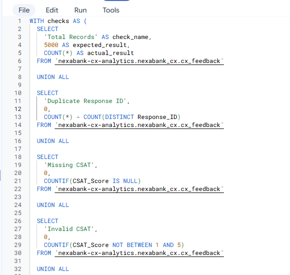
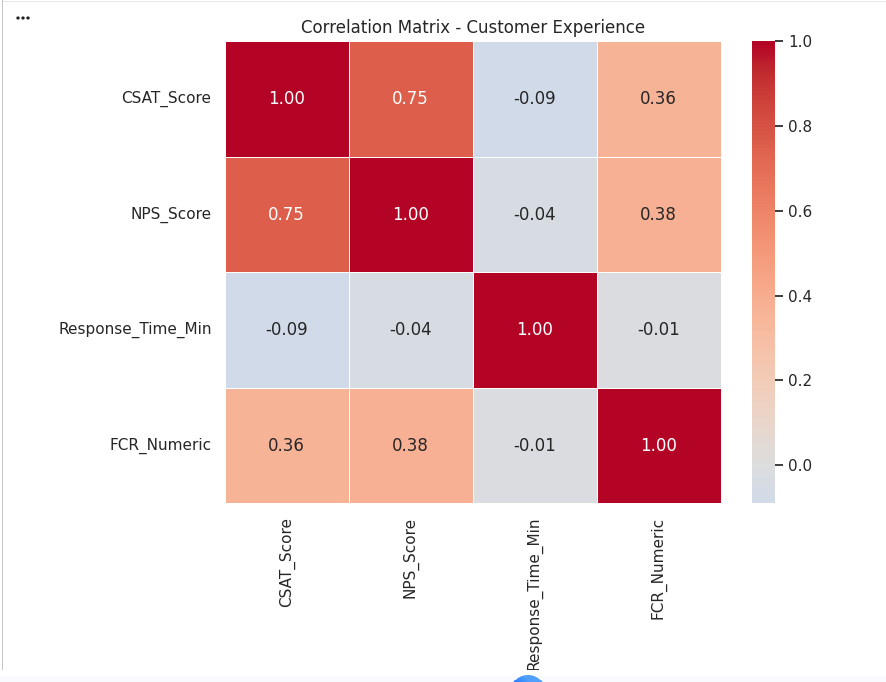

# Customer Experience Analytics Dashboard: CSAT & NPS

**Analyzing Customer Satisfaction, Customer Loyalty, and Service Performance for a Fictional Digital Bank**

## 1. Project Overview

This project analyzes customer experience data for **NexaBank**, a fictional digital banking institution, to evaluate customer satisfaction, customer loyalty, and service performance across multiple customer service channels.

The analysis uses Customer Satisfaction Score (CSAT), Net Promoter Score (NPS), First Contact Resolution (FCR), resolution status, and first response time to identify service performance patterns and potential areas for improvement.

The project demonstrates an end-to-end analytics workflow, from data validation and cleaning to exploratory data analysis, SQL analysis, and interactive dashboard development.

> **Disclaimer:** NexaBank and all customer records in this project are fictional. The dataset is synthetically generated for educational and portfolio purposes. Findings should not be interpreted as actual customer feedback or real banking performance.

## 2. Business Objectives

The project aims to answer the following business questions:

- How satisfied are customers with NexaBank's services?
- What is the overall Net Promoter Score?
- Which customer service channels perform better or worse?
- Which banking services have the highest unresolved rates?
- How do CSAT and NPS change over time?
- Is First Contact Resolution associated with customer satisfaction?
- Is first response time associated with CSAT and NPS?
- Which areas should be prioritized for further investigation?

## 3. Dataset Overview

| Attribute | Description |
|---|---|
| Institution | NexaBank (fictional) |
| Dataset type | Synthetic |
| Total records | 5,000 |
| Total columns | 14 |
| Date range | November 1, 2025 – October 31, 2026 |
| Industry | Digital Banking |
| Data format | CSV |

### Dataset Columns

| Column | Description |
|---|---|
| Response_ID | Unique survey response identifier |
| Response_Date | Date of survey response |
| Customer_ID | Customer identifier |
| Customer_Segment | Customer segment |
| City | Customer city |
| Channel | Customer service channel |
| Service_Type | Banking service type |
| Issue_Category | Reported issue category |
| CSAT_Score | Customer satisfaction score (1–5) |
| NPS_Score | Customer recommendation score (0–10) |
| Feedback | Customer feedback text |
| Resolution_Status | Resolved or Unresolved |
| First_Contact_Resolution | Whether the issue was resolved on first contact |
| Response_Time_Min | Time to first response, in minutes |

### Service Channels

- Mobile App
- Chatbot
- Call Center
- Email

### Banking Services

- Fund Transfer
- Bill Payment
- Account Access
- Card Services
- Account Opening
- QRIS Payment

## 4. Tools & Technologies

- **SQL (Google BigQuery):** Data validation, data cleaning, and analytical queries.
- **Python:** Data inspection, exploratory data analysis, statistical analysis, and visualization.
- **Libraries:** Pandas, NumPy, Matplotlib, and Seaborn.
- **Power BI:** Interactive executive dashboard development.
- **GitHub:** Project documentation and version control.

## 5. Project Workflow

### Step 1 — Data Understanding

- Loaded and inspected the synthetic dataset.
- Reviewed dataset dimensions, column names, data types, and descriptive statistics.
- Identified the analytical purpose of each variable.

### Step 2 — Data Quality Assessment & Cleaning

Used Google BigQuery to validate data integrity and check:

- Total record count.
- Duplicate Response IDs.
- Missing CSAT values.
- Invalid CSAT scores.
- Invalid NPS scores.
- Invalid FCR records.
- Negative response times.

**Validation results: 7 out of 7 checks passed.**

### Step 3 — Exploratory Data Analysis (EDA)

### Exploratory Data Analysis (EDA)

The exploratory analysis was conducted to understand customer experience patterns, identify performance differences across service channels and banking services, and explore relationships between operational and customer satisfaction metrics.

The analysis covered the following areas:

**1. CSAT and NPS Distribution Analysis**
- Examined the distribution of Customer Satisfaction (CSAT) scores on a scale of 1–5 to understand overall customer satisfaction levels.
- Calculated the percentage of satisfied customers (CSAT scores of 4–5) and compared it with neutral and dissatisfied responses.
- Classified Net Promoter Score (NPS) responses into Promoters (9–10), Passives (7–8), and Detractors (0–6).
- Calculated the overall NPS Index to evaluate customer loyalty and willingness to recommend the bank.
- Compared the distribution of CSAT and NPS responses to identify potential differences between customer satisfaction and customer advocacy.

**2. Response Time Distribution and Potential Outlier Analysis**
- Analyzed the distribution of first response times to understand how quickly customers received an initial response across service interactions.
- Examined descriptive statistics, including mean, median, minimum, maximum, and quartiles, to understand response time patterns.
- Used the Interquartile Range (IQR) method to identify potential outliers in response time data.
- Investigated unusually high response time values and considered how extreme observations could affect the average.
- Compared mean and median response times to assess the impact of skewed distributions.

*Note: Response time represents the time to first response, not the total time required to resolve a customer issue.*

**3. Customer Service Channel Performance Analysis**
- Compared customer experience performance across Mobile App, Chatbot, Call Center, and Email channels.
- Evaluated the number of survey responses to understand the distribution of customer interactions across channels.
- Compared average CSAT scores and CSAT satisfaction rates to identify channels with relatively stronger or weaker satisfaction performance.
- Examined average first response times to understand differences in response speed across channels.
- Reviewed resolution status and First Contact Resolution (FCR) rates to assess service resolution performance.
- Identified channels that may require further investigation based on their satisfaction, response time, and resolution indicators.

**4. Banking Service Performance Analysis**
- Compared customer experience across six banking services: Account Access, Card Services, Fund Transfer, Account Opening, QRIS Payment, and Bill Payment.
- Evaluated response volume, average CSAT scores, and unresolved rates for each service category.
- Identified services with relatively higher satisfaction levels and lower unresolved rates.
- Highlighted services with comparatively lower satisfaction and higher unresolved rates as potential areas for service improvement.
- Used the findings to identify which banking services may benefit from further operational investigation.

**5. Monthly CSAT and NPS Trend Analysis**
- Analyzed monthly CSAT satisfaction rates and NPS Index values from November 2025 to October 2026.
- Tracked monthly changes to understand how customer satisfaction and customer advocacy evolved over the observation period.
- Identified months with the highest and lowest CSAT and NPS performance.
- Compared CSAT and NPS trends to identify periods where customer satisfaction and willingness to recommend the bank moved differently.
- Highlighted notable monthly fluctuations that could be investigated further using additional operational or customer feedback data.

**6. Correlation Analysis Between Customer Experience Metrics**
- Examined the relationships between CSAT scores, NPS scores, First Contact Resolution (FCR), and first response time.
- Used correlation analysis to understand the direction and strength of relationships between selected variables.
- Identified a positive correlation between CSAT and NPS (r = 0.753), indicating that higher satisfaction scores tended to be associated with higher NPS scores.
- Observed positive correlations between FCR and NPS (r = 0.382), as well as FCR and CSAT (r = 0.365).
- Found weak negative correlations between first response time and CSAT (r = -0.090), and between first response time and NPS (r = -0.039).
- Interpreted the results as descriptive relationships rather than evidence of causation.

*Note: Correlation does not imply causation. The analysis identifies patterns in the synthetic dataset and does not establish that one metric directly causes changes in another.*

### Step 4 — Power BI Dashboard

Developed a one-page Executive Overview dashboard with:

- Total Responses
- CSAT Percentage
- NPS Index
- Resolution Rate
- FCR Rate
- Average CSAT Score
- Average First Response Time
- Monthly CSAT Trend
- Monthly NPS Trend
- NPS Distribution
- Survey Responses by Channel
- Service Performance Summary

## 6. Key Performance Indicators

| KPI | Definition |
|---|---|
| CSAT % | Percentage of responses with a score of 4 or 5 |
| NPS Index | Percentage of Promoters minus percentage of Detractors |
| Promoters | NPS scores of 9–10 |
| Passives | NPS scores of 7–8 |
| Detractors | NPS scores of 0–6 |
| FCR Rate | Percentage of responses marked as resolved on first contact |
| Resolution Rate | Percentage of responses with Resolved status |
| Average First Response Time | Average time until the first response, in minutes |

## 7. Key Findings

### Overall Customer Experience

| Metric | Result |
|---|---:|
| Total Responses | 5,000 |
| CSAT | 49.86% |
| NPS Index | +13.24 |
| Average CSAT Score | 3.38 / 5 |
| Promoters | 44.60% |
| Passives | 24.04% |
| Detractors | 31.36% |

### Channel Performance

| Channel | Average CSAT | CSAT Satisfied | Unresolved Rate | FCR Rate |
|---|---:|---:|---:|---:|
| Call Center | 3.66 | 60.43% | 15.31% | 63.00% |
| Mobile App | 3.51 | 55.13% | 22.25% | 52.00% |
| Chatbot | 3.03 | 36.49% | 35.96% | 44.00% |
| Email | 2.91 | 32.11% | 24.57% | 48.00% |

**Observation:**
- Call Center recorded the highest average CSAT and FCR rate among the four channels.
- Chatbot had the highest unresolved rate.
- Email had the lowest average CSAT and the longest average first response time.

Email's average first response time was 212.70 minutes, compared with a median of 186.95 minutes.

### Service Performance

| Service | Average CSAT | Unresolved Rate |
|---|---:|---:|
| Account Access | 3.62 | 17.92% |
| Card Services | 3.59 | 18.73% |
| Fund Transfer | 3.39 | 25.54% |
| Account Opening | 3.32 | 22.98% |
| QRIS Payment | 3.18 | 27.55% |
| Bill Payment | 3.12 | 30.97% |

**Observation:**
- Account Access had the highest average CSAT and lowest unresolved rate.
- Bill Payment had the lowest average CSAT and highest unresolved rate.
- QRIS Payment also showed an opportunity for further service investigation.

### Monthly Trends

- January 2026 recorded the highest CSAT at 54.52%.
- April 2026 recorded the lowest CSAT at 47.13%.
- January 2026 recorded the highest NPS Index at +24.29.
- September 2026 recorded the lowest NPS Index at +6.82.

These fluctuations indicate that customer experience metrics should be monitored over time rather than evaluated only through overall averages.

### Correlation Analysis

| Relationship | Pearson Correlation |
|---|---:|
| CSAT – NPS | +0.753 |
| FCR – NPS | +0.382 |
| FCR – CSAT | +0.365 |
| Response Time – CSAT | -0.090 |
| Response Time – NPS | -0.039 |
| Response Time – FCR | -0.015 |

**Observation:**
- CSAT and NPS have a strong positive correlation in this dataset.
- FCR has a positive correlation with both CSAT and NPS.
- First response time has very weak linear correlations with CSAT, NPS, and FCR.

## 8. Business Insights & Recommendations

## Business Insights & Recommendations

Based on the exploratory data analysis, four key areas were identified as potential opportunities for improving customer experience and service performance.

The recommendations focus on further investigating operational patterns, identifying potential contributing factors, and defining measurable improvement indicators.

### 1. Chatbot: Improve Issue Handling and Conversation Flow

**Key Finding**

The Chatbot recorded the highest unresolved rate among the service channels, at 35.96%.

**Business Insight**

A high unresolved rate does not necessarily indicate that the chatbot is failing. Certain issues involving sensitive personal or account information may legitimately require human agent assistance due to privacy and security considerations.

However, issues that can be handled through automation may indicate opportunities to improve intent recognition, conversation accuracy, and escalation logic.

**Recommendations**
- Analyze unresolved chatbot interactions by issue category and identify categories or combinations of issues contributing the highest unresolved volume and rate.
- Distinguish between cases that legitimately require human agent intervention and those that could potentially be resolved through self-service.
- For issues suitable for automation, review conversation flows to assess whether the chatbot accurately identifies customer intent and provides relevant responses.
- Investigate potential gaps in intent recognition, response accuracy, conversation routing, and escalation logic.
- Review whether escalation to human agents occurs at the appropriate stage of the conversation.

**Success Metrics**
- Chatbot resolution rate.
- Unresolved rate.
- Human-agent escalation rate, segmented by escalation reason.
- Intent recognition accuracy.

**Expected Outcome**

Improve chatbot resolution effectiveness while ensuring that sensitive customer issues are appropriately escalated to human agents.

### 2. Email: Investigate First Response Time and Workload Distribution

**Key Finding**

Email recorded the longest average first response time among the service channels, at 212.70 minutes.

**Business Insight**

The long average first response time indicates a potential service efficiency issue. However, the average alone does not explain when delays occur, which issue categories are affected, or whether workload distribution contributes to the problem.

**Recommendations**
- Examine the distribution of email first response times, including the median, upper percentiles, and potential extreme values.
- Analyze response time patterns by day, hour, and issue category to identify periods and types of issues associated with longer delays.
- If agent-level data is available, evaluate response time and workload distribution across agents to identify potential workload imbalances or operational bottlenecks.
- Review whether certain issue categories require specialized handling or additional processing time.
- Evaluate email handling procedures and identify opportunities to improve workload allocation and response efficiency.

**Success Metrics**
- Median first response time.
- 90th percentile (P90) first response time.
- Percentage of responses meeting the service-level agreement (SLA).
- Average workload and response time per agent, if available.

**Expected Outcome**

Identify the operational patterns associated with delayed email responses and support improvements in workload management and service efficiency.

### 3. Bill Payment: Investigate Recurring Payment Issues

**Key Finding**

Bill Payment recorded the highest unresolved rate among the banking service categories, at 30.97%.

**Business Insight**

The high unresolved rate suggests that Bill Payment requires further investigation, particularly regarding transaction-related problems such as payment failures and payments that have not been reflected in customer accounts.

These issues may involve service processes or underlying technical problems that cannot be fully identified using the current dataset.

**Recommendations**
- Conduct a more detailed analysis of Bill Payment complaints, focusing on Payment Failed and Payment Not Reflected issues.
- Identify the most frequent problem categories and examine their contribution to unresolved cases.
- Collaborate with the IT and technical teams to investigate potential transaction processing errors, payment gateway issues, system integration problems, and transaction status synchronization.
- Ensure that identified technical problems are investigated and addressed by the responsible teams.
- Monitor recurring payment issues and customer feedback after corrective actions have been implemented.

**Success Metrics**
- Bill Payment unresolved rate.
- Payment failure rate.
- Payment not reflected incident rate.
- Number of recurring payment-related complaints.
- Resolution rate for payment-related issues.

**Expected Outcome**

Identify recurring payment-related problems and support technical improvements that reduce unresolved cases and improve the reliability of the customer payment experience.

### 4. Call Center: Identify Effective First Contact Resolution Practices

**Key Finding**

The Call Center recorded a First Contact Resolution (FCR) rate of 63%, making it a useful channel for further investigation into effective issue-handling practices.

**Business Insight**

The FCR result provides an opportunity to understand which issue categories are more likely to be resolved during the first interaction and what handling practices may contribute to successful resolution.

Rather than assuming that all Call Center practices are effective, further analysis is needed to identify patterns associated with higher FCR performance.

**Recommendations**
- Analyze FCR rates by issue category to identify which types of customer problems are more frequently resolved during the first interaction.
- Review agent handling procedures, troubleshooting steps, knowledge resources, and resolution workflows for categories with relatively high FCR rates.
- Compare handling patterns between issue categories with high and low FCR rates.
- Identify effective practices that could potentially be adapted to other service channels where appropriate.
- Investigate categories with lower FCR rates to identify opportunities for better agent support, process improvements, or escalation procedures.

**Success Metrics**
- Overall FCR rate.
- FCR rate by issue category.
- Repeat contact rate.
- Resolution rate.
- Customer satisfaction by FCR status.

**Expected Outcome**

Identify effective issue-handling practices that may help improve first-contact resolution, reduce repeated customer interactions, and support a more consistent service experience.

### Improvement Prioritization

Based on the observed performance indicators, the following preliminary priorities are proposed:

| Priority | Area | Main Reason |
|---|---|---|
| High | Bill Payment | Highest unresolved rate among banking services (30.97%) |
| High | Chatbot | Highest unresolved rate among service channels (35.96%) |
| Medium | Email | Longest average first response time (212.70 minutes) |
| Medium | Call Center | Opportunity to identify and learn from practices associated with a 63% FCR rate |

These priorities are preliminary and should be reassessed using case volume, business impact, operational costs, and service-level requirements. The unresolved rates across channels and banking services represent different levels of analysis and should not be directly compared as if they were the same category.

### Further Data Requirements

Additional operational data would help validate the findings and support deeper investigation:

| Area | Additional Data Required |
|---|---|
| Chatbot | Conversation logs, detected customer intent, escalation reasons, and conversation outcomes |
| Email | Agent ID, ticket timestamps, working hours, and issue categories |
| Bill Payment | Transaction status, failure reasons, payment gateway responses, and reconciliation records |
| Call Center | Agent handling records, issue categories, repeat contact indicators, and resolution outcomes |

### Continuous Monitoring and Evaluation

Customer experience improvement should be treated as an ongoing process rather than a one-time initiative.

Recommended monitoring activities include:
- Track relevant customer experience and operational KPIs regularly.
- Establish baseline performance before implementing improvement initiatives.
- Compare KPI performance before and after corrective actions.
- Evaluate whether improvements in one service channel affect other channels.
- Investigate recurring issues and unexpected KPI deterioration.
- Validate improvement outcomes using actual operational data.

**Overall Recommendation**

The analysis suggests that improving customer experience requires more than reducing response time. Effective issue resolution, accurate customer intent recognition, technical reliability, appropriate human-agent escalation, and consistent service handling should

## 9. Limitations

- The dataset is synthetic and does not represent actual customer behavior or operational performance.
- Feedback comments are synthetically generated and should not be treated as genuine customer verbatim.
- CSAT and NPS are included in the same dataset for analytical simplicity; actual survey programs may collect them separately.
- Response time represents time to first response, not total resolution time.
- The dataset does not include queue waiting time, staffing levels, issue complexity, resolution duration, or repeat-contact records.
- Outliers in response time were investigated but not automatically removed, since extreme values may represent meaningful observations.

## 10. Project Outcome

This project demonstrates an end-to-end customer experience analytics workflow, combining customer service metrics, SQL-based data validation, Python exploratory analysis, and Power BI visualization.

The resulting dashboard provides an executive-level view of customer satisfaction, customer loyalty, channel performance, and service quality patterns, while translating analytical observations into potential business investigation priorities.

---

**Project Type:** Data Analytics / Customer Experience Analytics  
**Industry:** Digital Banking  
**Dataset:** Synthetic  
**Tools:** BigQuery SQL, Python, Power BI, GitHub
