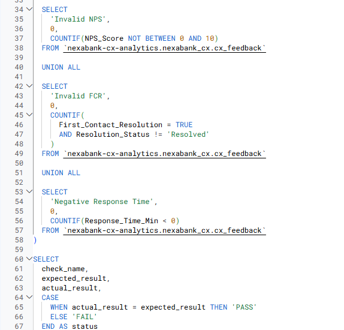
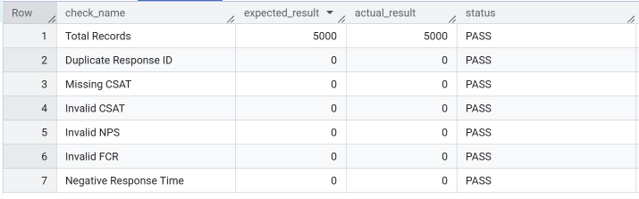
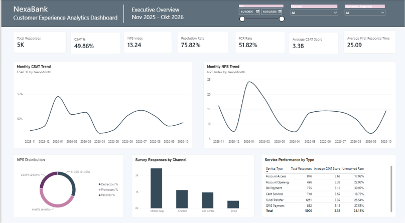

# Customer Experience Analytics Dashboard: CSAT & NPS

**Analyzing Customer Satisfaction, Customer Loyalty, and Service Performance for a Fictional Digital Bank**

## 1. Project Overview

This project analyzes customer experience data for **NexaBank**, a fictional digital banking institution, to evaluate customer satisfaction, customer loyalty, and service performance across multiple customer service channels.

The analysis uses Customer Satisfaction Score (CSAT), Net Promoter Score (NPS), First Contact Resolution (FCR), resolution status, and first response time to identify service performance patterns and potential areas for improvement.

The project demonstrates an end-to-end analytics workflow, from data validation and cleaning to exploratory data analysis, SQL analysis, and interactive dashboard development.

> **Disclaimer:** NexaBank and all customer records in this project are fictional. The dataset is synthetically generated for educational and portfolio purposes. Findings should not be interpreted as actual customer feedback or real banking performance.

## 2. Business Objectives

The project aims to answer the following business questions:

- How satisfied are customers with NexaBank's services?
- What is the overall Net Promoter Score?
- Which customer service channels perform better or worse?
- Which banking services have the highest unresolved rates?
- How do CSAT and NPS change over time?
- Is First Contact Resolution associated with customer satisfaction?
- Is first response time associated with CSAT and NPS?
- Which areas should be prioritized for further investigation?

## 3. Dataset Overview

| Attribute | Description |
|---|---|
| Institution | NexaBank (fictional) |
| Dataset type | Synthetic |
| Total records | 5,000 |
| Total columns | 14 |
| Date range | November 1, 2025 – October 31, 2026 |
| Industry | Digital Banking |
| Data format | CSV |

### Dataset Columns

| Column | Description |
|---|---|
| Response_ID | Unique survey response identifier |
| Response_Date | Date of survey response |
| Customer_ID | Customer identifier |
| Customer_Segment | Customer segment |
| City | Customer city |
| Channel | Customer service channel |
| Service_Type | Banking service type |
| Issue_Category | Reported issue category |
| CSAT_Score | Customer satisfaction score (1–5) |
| NPS_Score | Customer recommendation score (0–10) |
| Feedback | Customer feedback text |
| Resolution_Status | Resolved or Unresolved |
| First_Contact_Resolution | Whether the issue was resolved on first contact |
| Response_Time_Min | Time to first response, in minutes |

### Service Channels

- Mobile App
- Chatbot
- Call Center
- Email

### Banking Services

- Fund Transfer
- Bill Payment
- Account Access
- Card Services
- Account Opening
- QRIS Payment

## 4. Tools & Technologies

- **SQL (Google BigQuery):** Data validation, data cleaning, and analytical queries.
- **Python:** Data inspection, exploratory data analysis, statistical analysis, and visualization.
- **Libraries:** Pandas, NumPy, Matplotlib, and Seaborn.
- **Power BI:** Interactive executive dashboard development.
- **GitHub:** Project documentation and version control.

## 5. Project Workflow

### Step 1 — Data Understanding

- Loaded and inspected the synthetic dataset.
- Reviewed dataset dimensions, column names, data types, and descriptive statistics.
- Identified the analytical purpose of each variable.

### Step 2 — Data Quality Assessment & Cleaning

Used Google BigQuery to validate data integrity and check:

- Total record count.
- Duplicate Response IDs.
- Missing CSAT values.
- Invalid CSAT scores.
- Invalid NPS scores.
- Invalid FCR records.
- Negative response times.

**Validation results: 7 out of 7 checks passed.**

### Step 3 — Exploratory Data Analysis (EDA)

The exploratory analysis covered:

- CSAT and NPS distributions.
- Response time distribution and potential outliers.
- Customer service channel performance.
- Banking service performance.
- Monthly CSAT and NPS trends.
- Correlation analysis between customer experience metrics.

### Step 4 — Power BI Dashboard

Developed a one-page Executive Overview dashboard with:

- Total Responses
- CSAT Percentage
- NPS Index
- Resolution Rate
- FCR Rate
- Average CSAT Score
- Average First Response Time
- Monthly CSAT Trend
- Monthly NPS Trend
- NPS Distribution
- Survey Responses by Channel
- Service Performance Summary

## 6. Key Performance Indicators

| KPI | Definition |
|---|---|
| CSAT % | Percentage of responses with a score of 4 or 5 |
| NPS Index | Percentage of Promoters minus percentage of Detractors |
| Promoters | NPS scores of 9–10 |
| Passives | NPS scores of 7–8 |
| Detractors | NPS scores of 0–6 |
| FCR Rate | Percentage of responses marked as resolved on first contact |
| Resolution Rate | Percentage of responses with Resolved status |
| Average First Response Time | Average time until the first response, in minutes |

## 7. Key Findings

### Overall Customer Experience

| Metric | Result |
|---|---:|
| Total Responses | 5,000 |
| CSAT | 49.86% |
| NPS Index | +13.24 |
| Average CSAT Score | 3.38 / 5 |
| Promoters | 44.60% |
| Passives | 24.04% |
| Detractors | 31.36% |

### Channel Performance

| Channel | Average CSAT | CSAT Satisfied | Unresolved Rate | FCR Rate |
|---|---:|---:|---:|---:|
| Call Center | 3.66 | 60.43% | 15.31% | 63.00% |
| Mobile App | 3.51 | 55.13% | 22.25% | 52.00% |
| Chatbot | 3.03 | 36.49% | 35.96% | 44.00% |
| Email | 2.91 | 32.11% | 24.57% | 48.00% |

**Observation:**
- Call Center recorded the highest average CSAT and FCR rate among the four channels.
- Chatbot had the highest unresolved rate.
- Email had the lowest average CSAT and the longest average first response time.

Email's average first response time was 212.70 minutes, compared with a median of 186.95 minutes.

### Service Performance

| Service | Average CSAT | Unresolved Rate |
|---|---:|---:|
| Account Access | 3.62 | 17.92% |
| Card Services | 3.59 | 18.73% |
| Fund Transfer | 3.39 | 25.54% |
| Account Opening | 3.32 | 22.98% |
| QRIS Payment | 3.18 | 27.55% |
| Bill Payment | 3.12 | 30.97% |

**Observation:**
- Account Access had the highest average CSAT and lowest unresolved rate.
- Bill Payment had the lowest average CSAT and highest unresolved rate.
- QRIS Payment also showed an opportunity for further service investigation.

### Monthly Trends

- January 2026 recorded the highest CSAT at 54.52%.
- April 2026 recorded the lowest CSAT at 47.13%.
- January 2026 recorded the highest NPS Index at +24.29.
- September 2026 recorded the lowest NPS Index at +6.82.

These fluctuations indicate that customer experience metrics should be monitored over time rather than evaluated only through overall averages.

### Correlation Analysis

| Relationship | Pearson Correlation |
|---|---:|
| CSAT – NPS | +0.753 |
| FCR – NPS | +0.382 |
| FCR – CSAT | +0.365 |
| Response Time – CSAT | -0.090 |
| Response Time – NPS | -0.039 |
| Response Time – FCR | -0.015 |

**Observation:**
- CSAT and NPS have a strong positive correlation in this dataset.
- FCR has a positive correlation with both CSAT and NPS.
- First response time has very weak linear correlations with CSAT, NPS, and FCR.

Correlation does not establish causation.

## 8. Business Insights & Recommendations

Based on the observed patterns, the following areas are recommended for further investigation.

| Area | Recommendation |
|---|---|
| Chatbot | Review chatbot conversation flows, issue coverage, and escalation mechanisms to human agents. |
| Email | Investigate long first response times and review response handling processes. |
| Bill Payment | Examine recurring payment issues, particularly Payment Failed and Payment Not Reflected categories. |
| First Contact Resolution | Investigate practices associated with the higher Call Center FCR rate and assess whether they can be adapted to other channels. |
| Monthly CX Monitoring | Monitor changes in CSAT, NPS, and unresolved rates to identify periods requiring further investigation. |

These recommendations are hypotheses for operational investigation, not confirmed root causes.

## 9. Limitations

- The dataset is synthetic and does not represent actual customer behavior or operational performance.
- Feedback comments are synthetically generated and should not be treated as genuine customer verbatim.
- CSAT and NPS are included in the same dataset for analytical simplicity; actual survey programs may collect them separately.
- Response time represents time to first response, not total resolution time.
- The dataset does not include queue waiting time, staffing levels, issue complexity, resolution duration, or repeat-contact records.
- Correlation analysis identifies statistical relationships but cannot establish causality.
- Outliers in response time were investigated but not automatically removed, since extreme values may represent meaningful observations.

## 10. Project Outcome

This project demonstrates an end-to-end customer experience analytics workflow, combining customer service metrics, SQL-based data validation, Python exploratory analysis, and Power BI visualization.

The resulting dashboard provides an executive-level view of customer satisfaction, customer loyalty, channel performance, and service quality patterns, while translating analytical observations into potential business investigation priorities.

---

**Project Type:** Data Analytics / Customer Experience Analytics  
**Industry:** Digital Banking  
**Dataset:** Synthetic  
**Tools:** BigQuery SQL, Python, Power BI, GitHub
